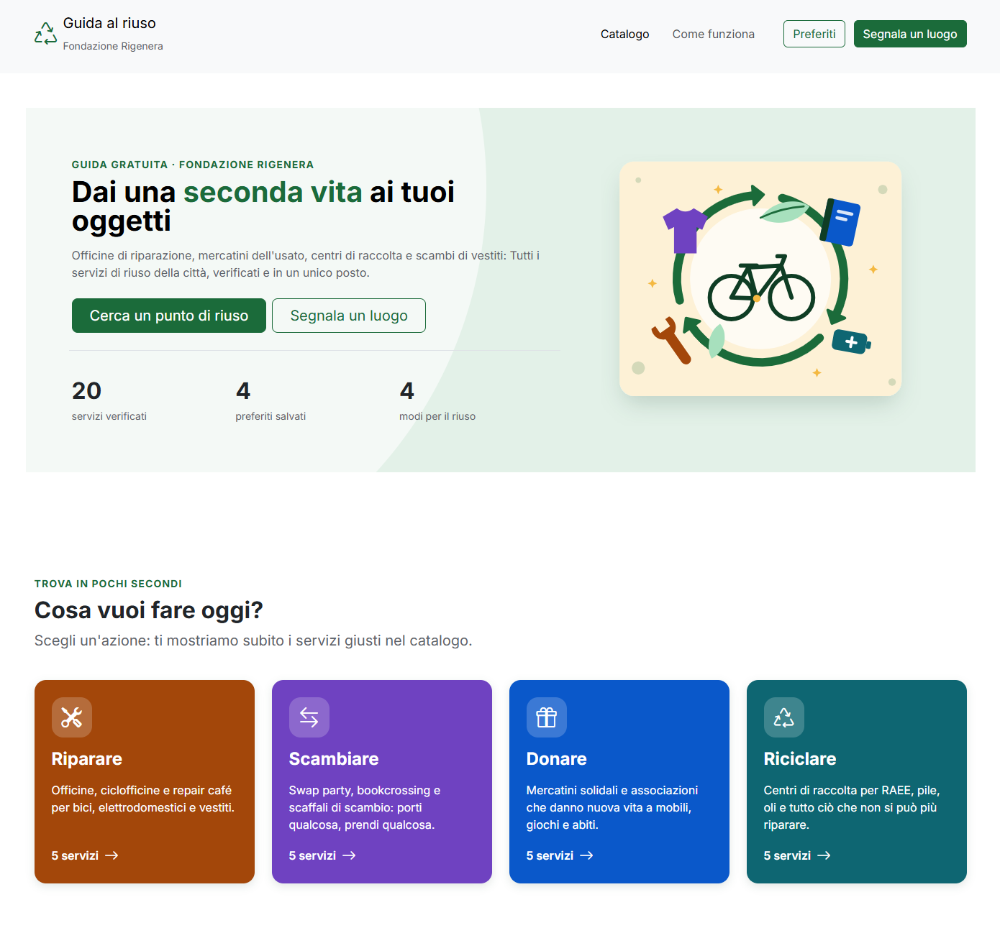
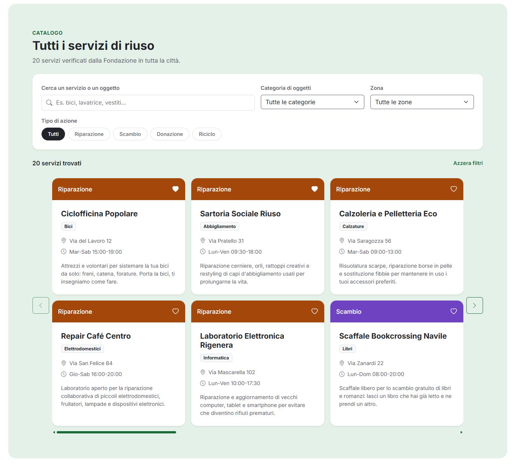

# 🌿 Fondazione Rigenera — Web Platform

Una piattaforma web moderna, responsive e accessibile sviluppata per **Fondazione Rigenera**, progettata per la consultazione e la fruizione dei servizi e delle iniziative sul territorio.

Il progetto è stato completamente refactorizzato secondo l'architettura **ES6 Modular JavaScript**, garantendo un'elevata manutenibilità, separazione delle responsabilità e caricamento dinamico dei dati.

link al deploy https://loris-battaglini.github.io/fondazione-rigenera/

---

## 📸 Preview del Progetto


_Figura 1: Header con navbar full-width e Hero section aggiornata._

<br>


_Figura 2: Catalogo dinamico con filtri di ricerca e gestione dei preferiti._


---

## ✨ Funzionalità Principali

- **🎨 UI/UX Responsive & Modern:** Navbar estesa a tutta larghezza (`container-fluid`) con `max-width` controllato e layout ottimizzato per mobile e desktop.
- **🧩 Architettura Modulare ES6:** Organizzazione pulita del codice JavaScript diviso in moduli dedicati (`components/`, `ui/`, `utils/`, `data/`).
- **📦 Carica i dati una sola volta con caricaServizi() dentro un try/catch e li passa a tutti i moduli. Nessuna variabile globale. CaricaServizi() restituisce l'array importato da mock/services.js: niente fetch.
- **🎠 Carosello Catalogo e Filtri:** Scorrimento fluido e filtri in tempo reale per categoria, tag e zona.
- **❤️ Gestione Preferiti:** Salvataggio dei servizi preferiti tramite `localStorage` con aggiornamento dinamico dello stato e contatori.

---

## 🛠️ Tech Stack

- **Frontend:** HTML5, SCSS / CSS3, Bootstrap 5
- **Logic & Scripts:** Vanilla JavaScript (ES6+ Modules)
- **Data Format:** JSON
- **Version Control:** Git & GitHub (Workflow a branch)

---

## 📁 Struttura del Progetto

```text
fondazione-rigenera/
├── assets/
│   ├── css/
│   │   ├── main.css
│   │   └── main.min.css
│   └── img/
├── js/
│   ├── components/
│   │   ├── cards.js
│   │   ├── counter.js
│   │   ├── favorites.js
│   │   ├── filters.js
│   │   └── report.js
│   ├── data/
│   │   ├── data.js
│   │   └── storage.js
│   ├── ui/
│   │   ├── error.js
│   │   ├── loading.js
│   │   └── navigation.js
│   └── app.js
├── mock/
│   └── service.js
├── scss/
│   ├── abstracts/
│   │   ├── _mixins.scss
│   │   └── _variables.scss
│   ├── components/
│   │   ├── _buttons.scss
│   │   ├── _cards.scss
│   │   ├── _forms.scss
│   │   └── _utilities.scss
│   ├── layout/
│   │   ├── _azioni.scss
│   │   ├── _catalogo.scss
│   │   ├── _container.scss
│   │   ├── _footer.scss
│   │   ├── _header.scss
│   │   ├── _navbar.scss
│   │   └── _report.scss
│   ├── _base.scss
│   └── main.scss
├── .gitignore
├── index.html
├── package-lock.json
├── package.json
└── README.md
```

## 🚀 Installazione e Avvio Locale

1. **Clona la repository:**

   ```bash
   git clone https://github.com/Loris-Battaglini/fondazione-rigenera.git
   cd fondazione-rigenera
   ```

2. **Installa le dipendenze e avvia il progetto:**

   ```bash
   npm install
   npx live-server
   ```

3. **Compilazione SCSS:**
   ```bash
   npm run build:css:all
   ```

## 👥 Contributori & Team Work

- Andrea Meini
- Anna Bonadimani
- Loris Battaglini
