# 🌿 Fondazione Rigenera — Web Platform

Una piattaforma web moderna, responsive e accessibile sviluppata per **Fondazione Rigenera**, progettata per la consultazione e la fruizione dei servizi e delle iniziative sul territorio[cite: 7].

Il progetto è stato completamente refactorizzato secondo l'architettura **ES6 Modular JavaScript**, garantendo un'elevata manutenibilità, separazione delle responsabilità e caricamento dinamico dei dati.

link al deploy https://loris-battaglini.github.io/fondazione-rigenera/

> ℹ️ **Dati di esempio:** i punti del catalogo (`mock/services.js`), con indirizzi, email e telefoni, sono fittizi e servono solo a dimostrare il funzionamento del sito.

---

## 📸 Preview del Progetto & Design

### 💻 Vista Desktop

|              Hero Section              |                    Catalogo Servizi                    |          Form di Segnalazione          |
| :------------------------------------: | :----------------------------------------------------: | :------------------------------------: |
| 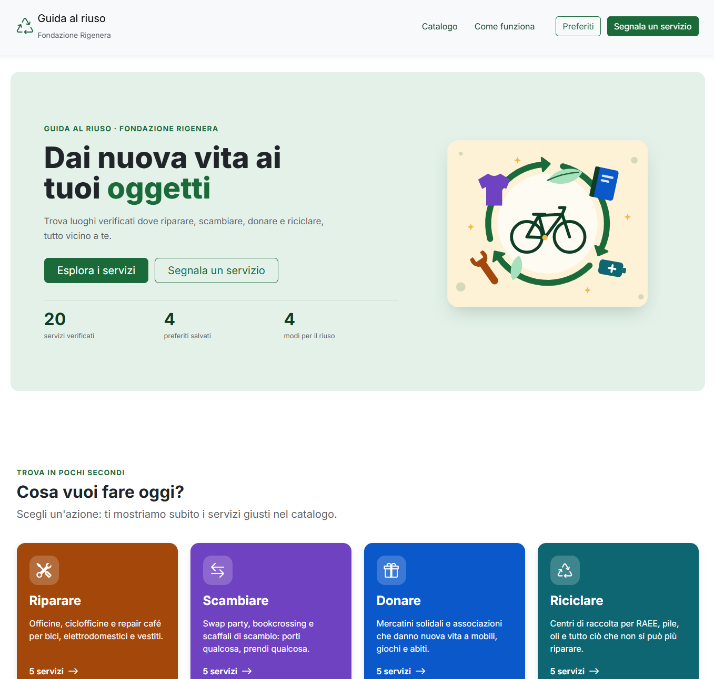 | 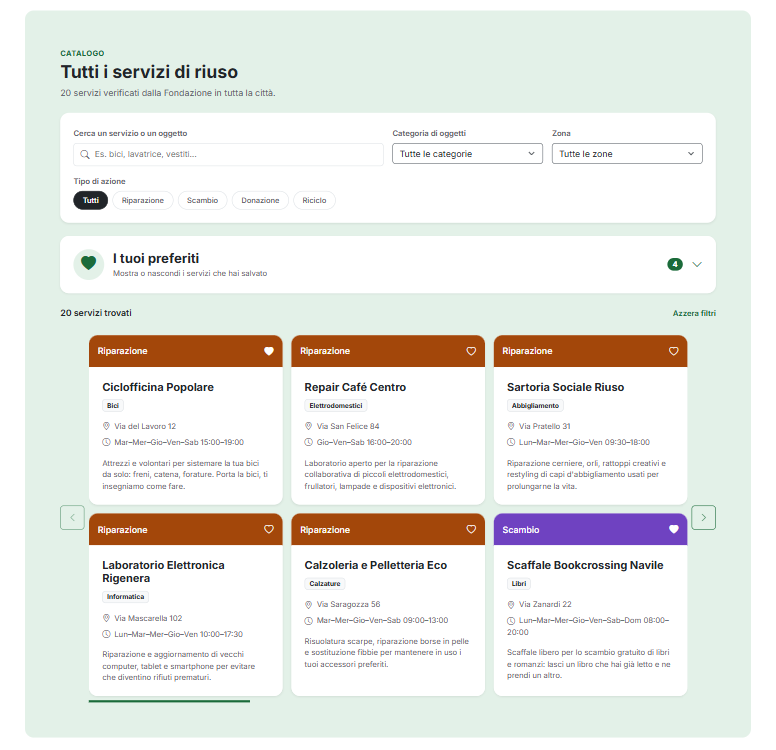 | 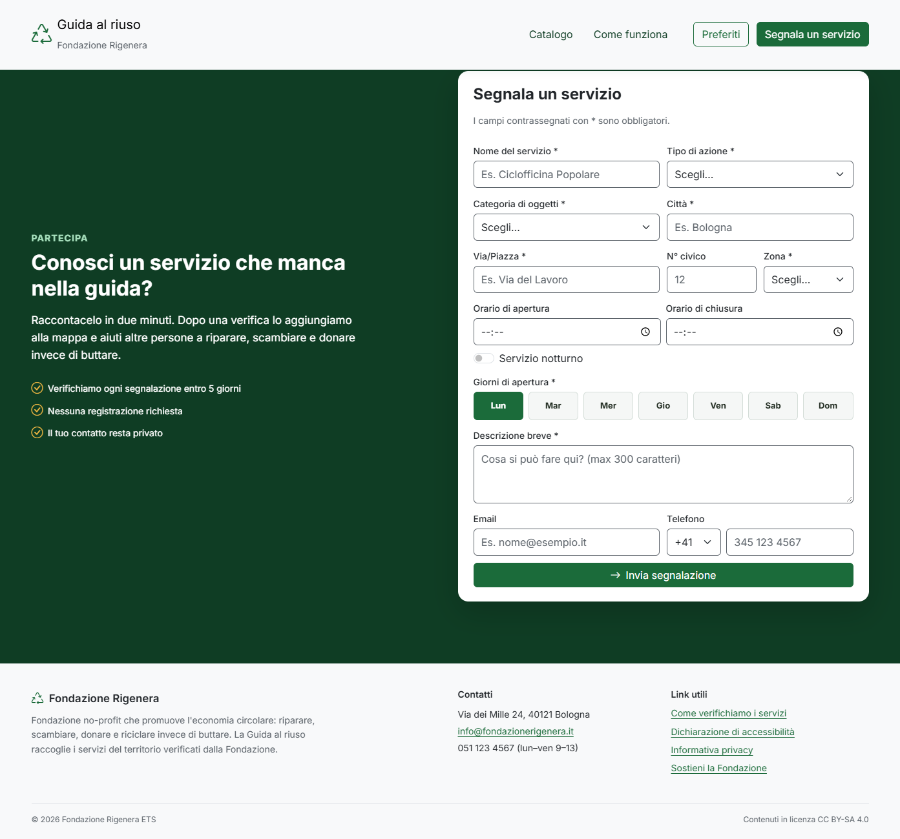 |

### 📱 Vista Mobile & Responsive

|                   Navbar Mobile                    |                    Catalogo Mobile                     |
| :------------------------------------------------: | :----------------------------------------------------: |
|  | 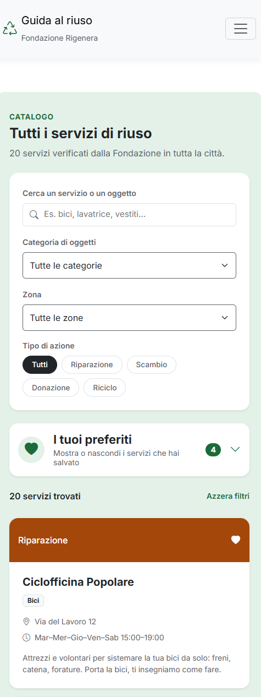 |

---

<details>
<summary><b>🎨 Sfoglia le slide di presentazione</b></summary>

<br>

#### 1. Il Cliente e il Problema

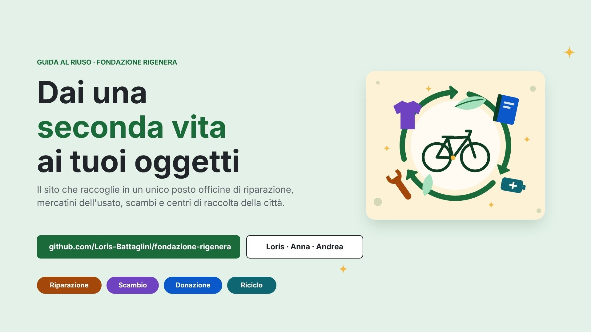

#### 2. Obiettivi e Vincoli Tecnici

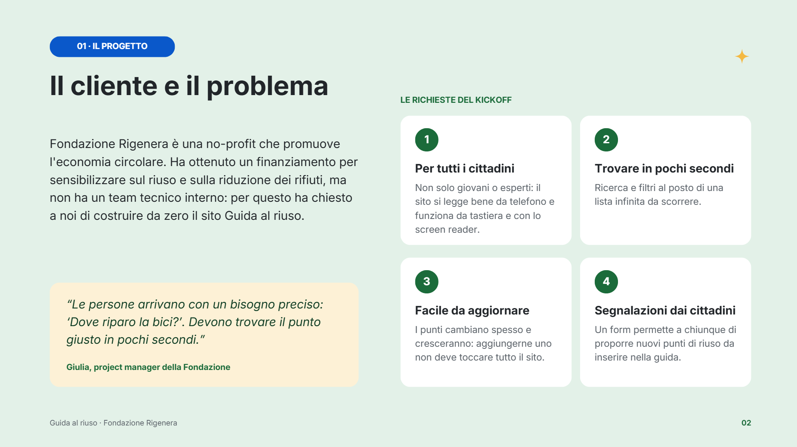

#### 3. Design System & Style Guide

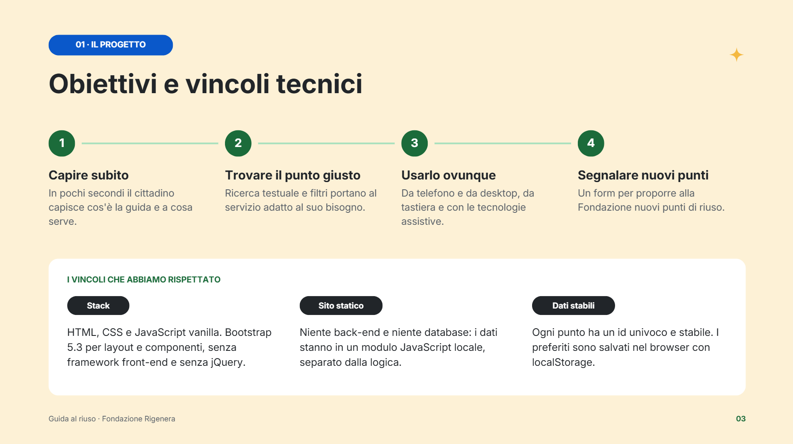

#### 4. Dal Design in Figma al Codice

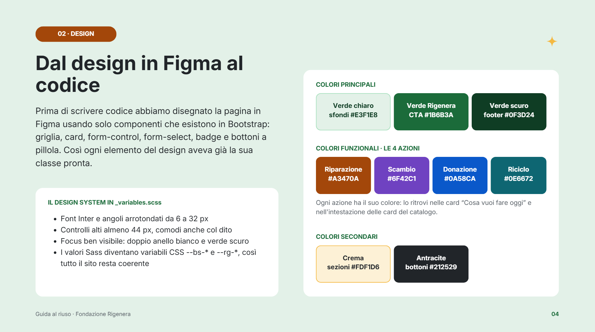

#### 5. Come è fatta la pagina

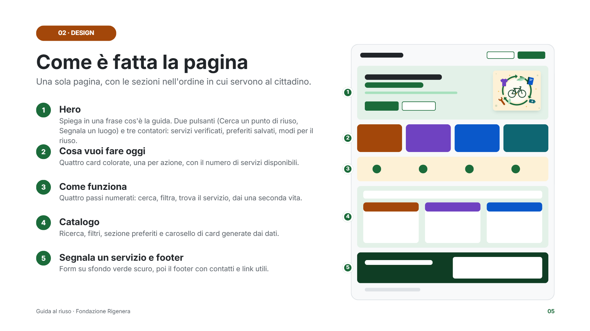

#### 6. Rendering Dinamico dei Dati

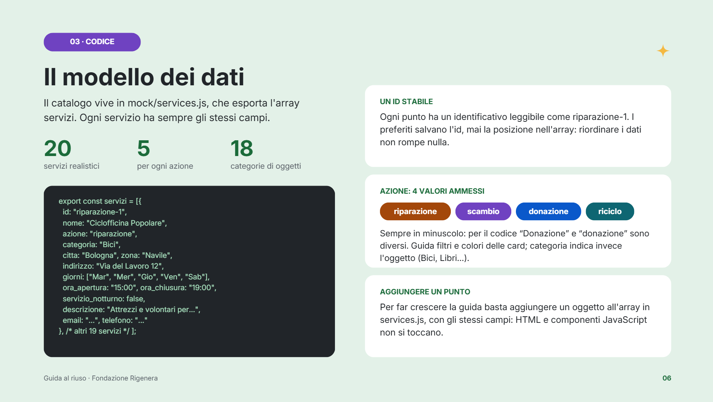

#### 7. Architettura del Codice

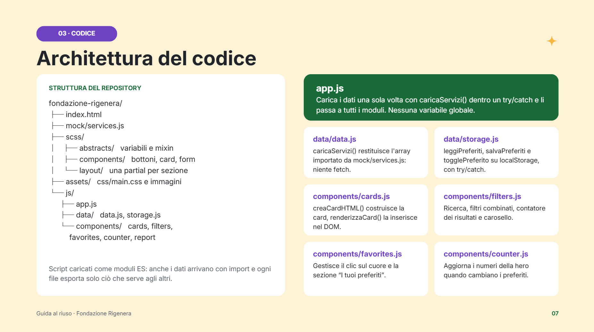

#### 8. Catalogo Dinamico

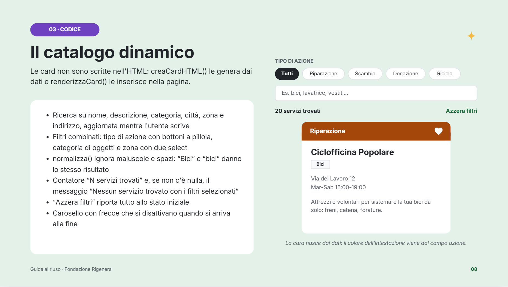

#### 9. Gestione Preferiti

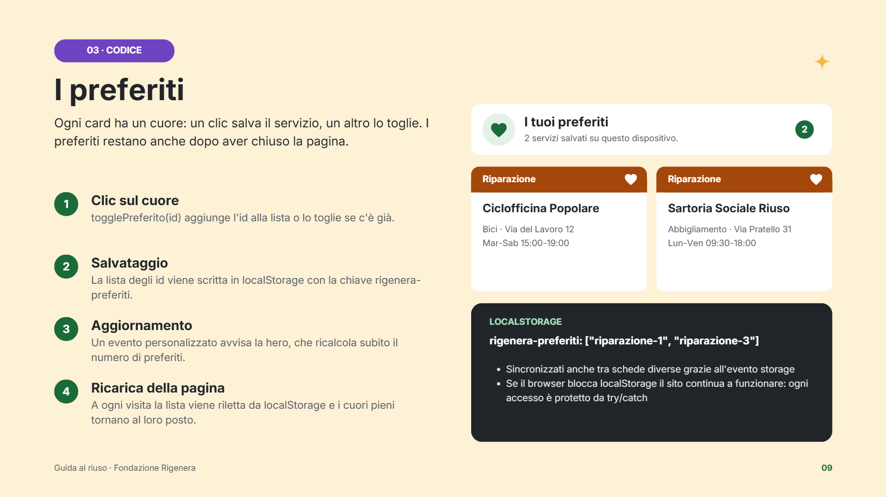

#### 10. Segnala un Servizio & Accessibilità

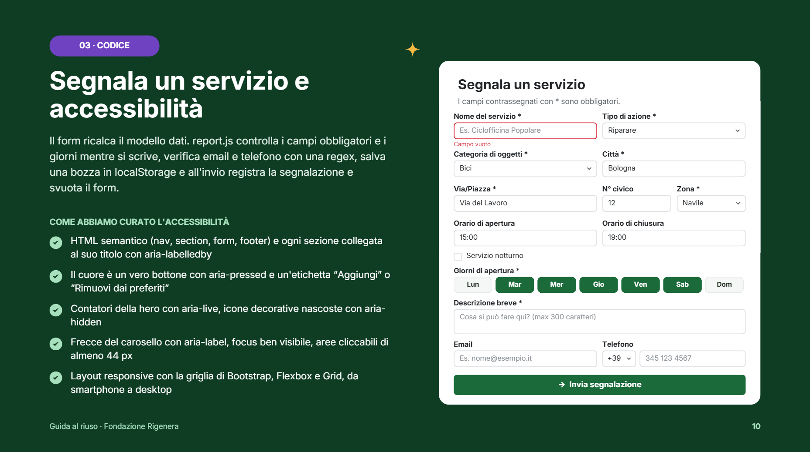

#### 11. Lavoro di Squadra & Git Workflow

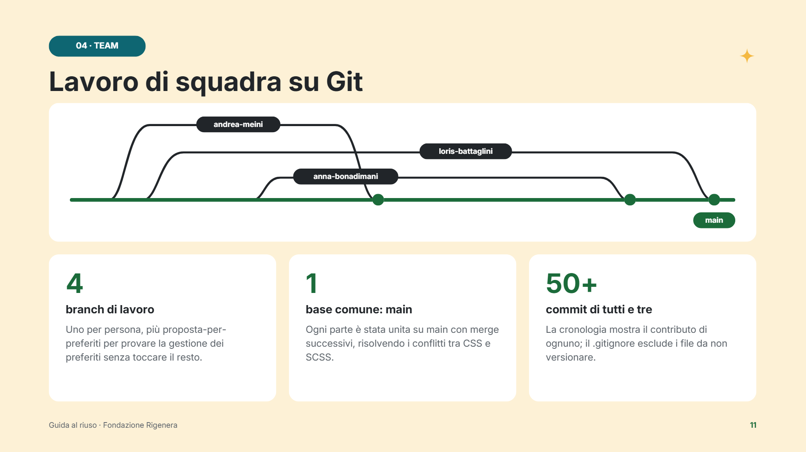

</details>

---

## ✨ Funzionalità Principali

- **🎨 UI/UX Responsive & Modern:** Navbar estesa a tutta larghezza (`container-fluid`) con `max-width` controllato e layout ottimizzato per mobile e desktop.
- **🧩 Architettura Modulare ES6:** Organizzazione pulita del codice JavaScript diviso in moduli dedicati (`components/`, `ui/`, `utils/`, `data/`).
- **📦 Rendering Dinamico dei Dati:** Le schede del catalogo vengono generate a runtime in JavaScript a partire dai servizi mockati, mantenendo l'HTML snello e privo di componenti statici.
- **🎠 Carosello Catalogo e Filtri:** Scorrimento fluido e filtri in tempo reale per categoria, tag e zona[cite: 7].
- **❤️ Gestione Preferiti:** Salvataggio dei servizi preferiti tramite `localStorage` con aggiornamento dinamico dello stato e contatori.

---

## 🛠️ Tech Stack

- **Frontend:** HTML5, SCSS / CSS3, Bootstrap 5[cite: 5]
- **Logic & Scripts:** Vanilla JavaScript (ES6+ Modules)[cite: 5]
- **Version Control:** Git & GitHub (Workflow a branch)

---

## 📁 Struttura del Progetto

```text
fondazione-rigenera/
├── assets/
│   ├── css/
│   │   ├── main.css
│   │   └── main.min.css
│   └── img/
├── js/
│   ├── components/
│   │   ├── cards.js
│   │   ├── counter.js
│   │   ├── favorites.js
│   │   ├── filters.js
│   │   └── report.js
│   ├── data/
│   │   ├── data.js
│   │   └── storage.js
│   ├── ui/
│   │   └── select.js
│   └── app.js
├── mock/
│   └── services.js
├── node_modules/
├── scss/
│   ├── abstracts/
│   │   └── _variables.scss
│   ├── components/
│   │   ├── _buttons.scss
│   │   ├── _cards.scss
│   │   ├── _forms.scss
│   │   └── _utilities.scss
│   ├── layout/
│   │   ├── _azioni.scss
│   │   ├── _catalogo.scss
│   │   ├── _container.scss
│   │   ├── _footer.scss
│   │   ├── _header.scss
│   │   ├── _navbar.scss
│   │   └── _report.scss
│   ├── _base.scss
│   └── main.scss
├── .gitignore
├── index.html
├── package-lock.json
├── package.json
└── README.md
```

## 🚀 Installazione e Avvio Locale

1. **Clona la repository:**

   ```bash
   git clone https://github.com/Loris-Battaglini/fondazione-rigenera.git
   cd fondazione-rigenera
   ```

2. **Installa le dipendenze e avvia il progetto:**

   ```bash
   npm install
   npx live-server
   ```

3. **Compilazione SCSS:**
   ```bash
   npm run build:css:all
   ```

## 🔭 Sviluppi futuri

- Preferiti suggeriti al primo avvio (servizi segnalati dalla Fondazione).
- Invio delle segnalazioni a un back end, al posto del salvataggio in `localStorage`.

## 👥 Contributori & Team Work

- Andrea Meini
- Anna Bonadimani
- Loris Battaglini
